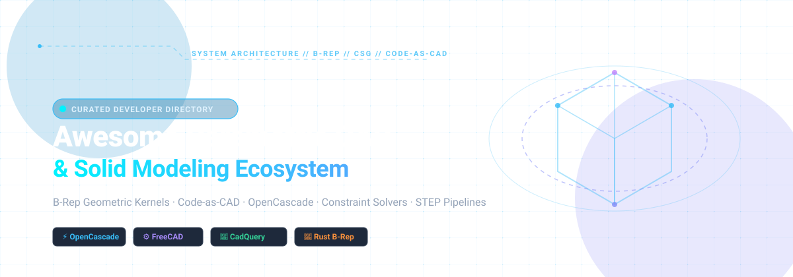

  

# 📐 Awesome Parametric CAD & Solid Modeling Ecosystem ⚙️

  
  
  
  
  
  

---

## 🚀 Overview & Scope

A curated collection of leading **SaaS platforms**, **open-source geometric kernels**, **Code-as-CAD frameworks**, and **constraint solvers** for **Parametric CAD and Solid Modeling**. This directory covers Boundary Representation (B-Rep), Constructive Solid Geometry (CSG), NURBS surfaces, WebAssembly CAD engines, and manufacturing-ready STEP, IGES, and STL/3MF pipelines.

Whether you are a mechanical engineer designing injection-molded assemblies, a robotics developer scripting parametric enclosures with Python/Rust, or a software engineer developing browser-based CAD apps, this repository tracks modern solid modeling tools and foundational kernels.

---

## 📑 Table of Contents
- [📊 Sector Overview & Market Dynamics](#-sector-overview--market-dynamics)
- [☁️ SaaS & Commercial Cloud Platforms](#️-saas--commercial-cloud-platforms)
- [💻 Open-Source GitHub Projects](#-open-source-github-projects)
- [🧩 Frameworks & Emerging Tools](#-frameworks--emerging-tools)
- [📈 Star History](#-star-history)
- [🤝 How to Contribute](#-how-to-contribute)
- [💖 Support](#-support)
- [⚖️ Disclaimer](#️-disclaimer)

---

## 📊 Sector Overview & Market Dynamics

The global **Computer-Aided Design (CAD) and Solid Modeling software market** is estimated at approximately **$11.2B to $14.1B in 2025–2026**, on track to surpass **$17B to $20B+ by 2030** with an annual growth rate (CAGR) of **5.8% to 7.5%**, propelled by cloud-native design workflows, collaborative SaaS environments, and generative AI CAD synthesis.

The commercial CAD industry is **moderately to highly concentrated** among an entrenched oligopoly of legacy engineering software giants—chiefly **Dassault Systèmes, Siemens Digital Industries Software, Autodesk, and PTC**—where high switching costs, proprietary file formats, and deep PLM integration create powerful "winner-take-most" network effects. Simultaneously, a thriving counter-wave of programmatic **Code-as-CAD** frameworks (`FreeCAD`, `CadQuery`, `build123d`, `OpenSCAD`, `truck`) and GPU/WebAssembly geometry startups (`Zoo/KittyCAD`, `Shapr3D`, `replicad`) is decentralizing access to solid modeling, driving vendor-independent STEP workflows and automated mechanical engineering pipelines.

---

## ☁️ SaaS & Commercial Cloud Platforms

The following table compares leading SaaS and cloud-connected parametric CAD applications, sorted by **Company Size (Annual Revenue / Enterprise Valuation)** in descending order:

| Platform | Developer / Parent | Company Size (Rev / Valuation) | Starting Paid Tier Price | Free Tier / Trial Limits | Core Focus & Solid Modeling Architecture |
| :--- | :--- | :--- | :--- | :--- | :--- |
| **[Siemens NX X (Cloud)](https://siemens.com)** | Siemens AG (`SIE.DE`) | **~$82.5B Annual Revenue** (Siemens AG) | **$250 / month** (billed annually for NX CAM / Design entry modules; full CAD from ~$600/mo) | **30-day full-access free cloud trial** (runs directly in browser, no credit card required) | Enterprise high-end hybrid modeling combining synchronous technology, convergent mesh modeling, and Teamcenter PLM. |
| **[SolidWorks Cloud & 3DEXPERIENCE](https://solidworks.com)** | Dassault Systèmes (`DSY.PA`) | **~$6.5B Annual Revenue** ($40B+ Market Cap) | **$235 / user / month** ($2,820/year for 3DEXPERIENCE SOLIDWORKS Standard; $48–$99/yr for Maker edition) | **14-day free trial** for commercial suites (requires business verification); Maker plan requires &lt;$2,000/yr revenue | Industry-standard parametric B-Rep solid modeler with cloud PDM, simulation, and parametric revision controls. |
| **[Autodesk Fusion](https://autodesk.com)** | Autodesk (`ADSK`) | **~$5.5B Annual Revenue** ($55B+ Market Cap) | **$85 / month** (or **$680 / year**) | **Free for Personal Use** (strictly non-commercial, &lt;$1,000/year revenue limit; max 10 active editable documents) | Cloud-connected integrated 3D parametric solid modeler, generative design engine, PCB CAD, and multi-axis CAM. |
| **[BricsCAD Pro](https://bricsys.com)** | Hexagon AB (`HEXA-B.ST`) | **~$5.7B Annual Revenue** (Hexagon AB) | **$780 / year** (subscription or perpetual license available) | **30-day unrestricted free trial** of BricsCAD Ultimate (Shape standalone free tier discontinued in V26) | Direct and parametric 3D solid modeler built natively on `.dwg` architecture with LISP and BIM workflows. |
| **[PTC Creo & Creo+](https://ptc.com)** | PTC Inc. (`PTC`) | **~$2.2B Annual Revenue** ($20B+ Market Cap) | **$250 / user / month** ($3,000 / year for Creo Design Essentials seat) | **14-day to 30-day full-access free trial** via Creo Launchpad (business verification required) | Enterprise parametric feature-based solid modeler featuring generative topology optimization and advanced surfacing. |
| **[Onshape](https://onshape.com)** | PTC (`PTC`) | **~$2.2B Parent Revenue** (Acquired for $470M) | **$125 / user / month** ($1,500 / year for Onshape Standard) | **100% Free Public Plan** (strictly non-commercial; all documents are public/open to everyone; 100MB private storage cap) | Pure cloud-native browser CAD platform offering multi-user live collaboration, FeatureScript automation, and built-in PDM. |
| **[Tinkercad](https://tinkercad.com)** | Autodesk (`ADSK`) | **Backed by Autodesk** ($55B+ Market Cap) | **Free ($0 / month)** (entry gateway to Autodesk ecosystem) | **Free forever without payment walls** (unlimited designs, non-commercial, browser-based CSG shape builder) | Intuitive Constructive Solid Geometry (CSG) modeling, Codeblocks scripting, and electronics simulation for rapid prototyping. |
| **[Rhino.Compute](https://rhino3d.com)** | Robert McNeel &amp; Associates | **~$50M - $100M Est. Revenue** (Private Bootstrapped) | **$0.10 / core / hour** for cloud Windows/Linux server instances | **Free local development** using existing workstation Rhino license; **90-day free trial** of full Rhino desktop | Headless cloud REST geometry server executing RhinoCommon NURBS and Grasshopper parametric graphs over HTTP APIs. |
| **[Shapr3D](https://shapr3d.com)** | Shapr3D Zrt. | **~$15M - $25M ARR** (Series B funded) | **$25 / month** ($299 / year billed annually for Pro / Solo tier) | **Free Basic Plan** (max 2 active designs, low-resolution STL/3MF export only, no 2D technical drawings or STEP export) | Multidevice Parasolid-based parametric and direct solid modeler designed for iPad Pencil, macOS, and Windows. |
| **[Zoo (Zoo Design Studio)](https://zoo.dev)** | Zoo Inc. (formerly KittyCAD) | **~$15M - $30M Seed / Series A** | **$20 / month** for Plus plan (unlimited manual CAD; paid compute for AI/KCL compilation) | **Free Plan** (unlimited manual modeling; 20 minutes/month of Zookeeper AI reasoning; public training opt-in) | AI-powered hardware design suite with Text-to-CAD, GPU-accelerated engine, and declarative KCL (KittyCAD Language). |

---

## 💻 Open-Source GitHub Projects

The following list contains open-source solid modeling applications, programmatic Code-as-CAD engines, and geometric kernels. Repositories are sorted by **GitHub Star Count** in descending order:

1. **[FreeCAD](https://github.com/FreeCAD/FreeCAD)**  
     
   The flagship general-purpose open-source parametric 3D CAD modeler powered by OpenCascade. Features PartDesign, Sketcher geometric constraint solver, Assembly, FEM analysis, and comprehensive Python scripting.

2. **[tangency-labs/solidcraft](https://github.com/tangency-labs/solidcraft)**  
     
   Modern open-source parametric 3D CAD application built in pure Rust. Features desktop and WebAssembly browser modeling, topological naming resistance, and AI automation via Model Context Protocol (MCP).

3. **[OpenSCAD](https://github.com/openscad/openscad)**  
     
   The definitive "Programmer's Solid 3D CAD Modeler". Compiles declarative Constructive Solid Geometry (CSG) text files into exact 3D models with fast Manifold-backed boolean evaluation.

4. **[CadQuery](https://github.com/CadQuery/cadquery)**  
     
   Python parametric CAD scripting framework built on OpenCascade (OCCT). Provides fluent selector-based APIs, 2D/3D workplanes, parametric assemblies, and native STEP/STL export.

5. **[CADAM (Adam-CAD)](https://github.com/Adam-CAD/CADAM)**  
     
   Open-source browser-based text-to-CAD application generating parametric boundary-representation models from natural language instructions.

6. **[SolveSpace](https://github.com/solvespace/solvespace)**  
     
   Ultra-compact, standalone 2D/3D parametric CAD system. Renowned for its lightning-fast geometric constraint solver, linkage simulation, STEP/DXF exports, and minimal memory footprint.

7. **[build123d](https://github.com/gumyr/build123d)**  
     
   Modern Pythonic CAD programming framework built on OpenCascade. Supports both imperative builder-mode context managers and declarative algebraic operations for intricate mechanical assemblies.

8. **[JSCAD (OpenJSCAD)](https://github.com/jscad/OpenJSCAD.org)**  
     
   Modular JavaScript and TypeScript programmatic CAD environment. Enables developers to build parametric 2D and 3D solid parts inside web browsers and Node.js microservices.

9. **[OpenCASCADE Technology (OCCT)](https://github.com/Open-Cascade-SAS/OCCT)**  
     
   The industrial standard open-source C++ 3D Boundary Representation (B-Rep) geometric modeling kernel powering FreeCAD, CadQuery, KiCad 3D, and Salome.

10. **[Fornjot](https://github.com/hannobraun/fornjot)**  
      
    Next-generation code-first B-Rep CAD kernel written from the ground up in Rust, featuring deterministic geometry generation and verifiable manifold meshes.

11. **[BOSL2 (Belfry OpenSCAD Library v2)](https://github.com/BelfrySCAD/BOSL2)**  
      
    Comprehensive, high-performance OpenSCAD library providing procedural masks, attachments, fillets, threads, shapes, and kinematic coordinate transformers.

12. **[Manifold](https://github.com/elalish/manifold)**  
      
    Guaranteed watertight, parallelized C++ mesh boolean and geometric library designed for real-time CSG evaluation in modern desktop and WebAssembly CAD engines.

13. **[Mayo (fougue/mayo)](https://github.com/fougue/mayo)**  
      
    Fast, cross-platform 3D CAD viewer and geometry converter based on Qt and OpenCascade supporting STEP, IGES, BREP, glTF, and OBJ with tree inspection.

14. **[Dune 3D](https://github.com/dune3d/dune3d)**  
      
    Contemporary open-source parametric 3D CAD software pairing the robust SolveSpace 2D/3D constraint solver with the OpenCascade B-Rep modeling kernel.

15. **[truck (ricosjp/truck)](https://github.com/ricosjp/truck)**  
      
    Pure Rust modular B-Rep shape modeling kernel with NURBS surface evaluation and WebGPU rendering pipelines for cloud-native mechanical CAD.

16. **[libfive](https://github.com/libfive/libfive)**  
      
    Infrastructure for solid modeling using Functional Representation (F-Rep) and Signed Distance Fields (SDF) with seamless blends and Guile/Python bindings.

17. **[NopSCADlib](https://github.com/nophead/NopSCADlib)**  
      
    Extensive open-source library of 3D mechanical components (motors, fasteners, pulleys, extrusions) and assembly automation framework for OpenSCAD.

18. **[ImplicitCAD](https://github.com/colah/ImplicitCAD)**  
      
    Math-inspired CAD program written in Haskell providing continuous CSG, smooth filleting, and beveling using implicit geometric functions.

19. **[CascadeStudio](https://github.com/zalo/CascadeStudio)**  
      
    Browser-based live-scripted CAD IDE combining OpenCascade.js, Monaco Editor, and Three.js for real-time parametric JavaScript modeling and STEP export.

20. **[Zoo Modeling App](https://github.com/KittyCAD/modeling-app)**  
      
    The official open-source client application for Zoo Design Studio, integrating declarative KCL code, real-time WebGPU canvas, and text-to-cad workflows.

21. **[SolidPython](https://github.com/SolidCode/SolidPython)**  
      
    Python frontend for solid modeling that compiles high-level Python code to procedural OpenSCAD scripts for rapid 3D fabrication.

22. **[Curv](https://github.com/curv3d/curv)**  
      
    Functional programming language designed for generative art and 3D solid modeling using mathematical Signed Distance Fields and infinite-resolution rendering.

23. **[BRL-CAD](https://github.com/BRL-CAD/brlcad)**  
      
    Veteran open-source combinatorial solid modeling system featuring ray tracing, thermal analysis, ballistic simulation, and high-performance CSG.

24. **[opencascade.js](https://github.com/donalffons/opencascade.js)**  
      
    Comprehensive WebAssembly port of OpenCascade via Emscripten, enabling full B-Rep solid modeling and STEP parsing in browser frontends.

25. **[replicad](https://github.com/sgenoud/replicad)**  
      
    Ergonomic JavaScript/TypeScript library built on `opencascade.js` for building 3D B-Rep CAD models with web-first declarative syntax and React integration.

26. **[OCP CAD Viewer (VS Code)](https://github.com/bernhard-42/vscode-ocp-cad-viewer)**  
      
    Interactive Three.js CAD viewer integrated directly inside Visual Studio Code for inspecting `build123d` and `CadQuery` solid models live during coding.

---

## 🧩 Frameworks & Emerging Tools

- **[Salome Platform](https://salome-platform.org)**: Open-source industrial pre- and post-processing CAD/CAE environment integrating the OpenCascade `Shaper` parametric module with advanced finite-element meshing (`SMESH`).
- **[KiCad 3D Kernel](https://gitlab.com/kicad/code/kicad)**: Embedded OpenCascade solid modeling pipeline inside KiCad for rendering accurate 3D PCB models and exporting mechanical enclosure STEP files.
- **Model Context Protocol (MCP) CAD Servers**: Emerging AI bridges enabling LLMs to execute deterministic CAD operations via FreeCAD Python, build123d scripts, and SolidCraft APIs.

---

## 📈 Star History

---

## 🤝 How to Contribute

Contributions from engineers, kernel developers, and makers are welcome!
1. **Fork** the repository.
2. Add your project or update entries in `README.md` keeping formatting clean, factual, and alphabetical or sorted where relevant.
3. Verify that URLs, pricing specifics, and GitHub star links are accurate.
4. Submit a **Pull Request** with a descriptive summary of your addition.

Refer to the master repository at [Awesome-Awesome-Awesome](https://github.com/ishandutta2007/Awesome-Awesome-Awesome) for related curated engineering toolkits.

---

## 💖 Support

If you find this curated directory useful for your engineering work, 3D printing projects, or CAD pipeline development, please consider showing your support:
- ⭐ **Star** this repository to help other developers and engineers discover it!
- 🍴 **Fork** and share it with your robotics, mechanical, or hardware engineering teams.
- ☕ **Buy me a coffee / Sponsor**: Support ongoing maintenance, research, and curation on the **[GitHub Sponsors Dashboard](https://github.com/sponsors/ishandutta2007)**.

Thank you to all contributors and open-source CAD maintainers who push open engineering forward! 🚀

---

## ⚖️ Disclaimer

- This is a community-maintained curated directory provided for informational and educational purposes.
- Precision manufacturing (CNC milling, sheet metal stamping, injection molding, SLA/SLS/FDM 3D printing) requires verified geometric tolerances, manifold shells, and standardized exports (`STEP AP242 / AP214`). Always validate geometry in a CAM toolpath verifier or slicer before cutting physical material.
- Trademarks, product names, and logos belong to their respective corporate owners (Autodesk, Dassault Systèmes, Siemens, PTC, Hexagon, McNeel, etc.).

---

  <b>Built with ❤️ for mechanical engineers, CAD kernel architects, makers, and hardware innovators worldwide.</b>

